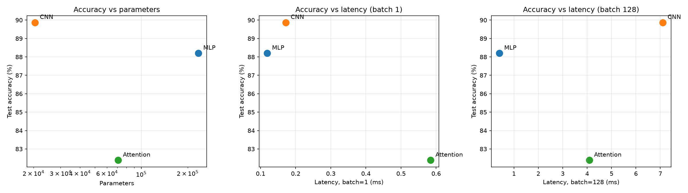

# Lab 3: Architectures and their Costs

## 1. Setup
Fashion-MNIST, Normalize((0.2860,), (0.3530,)), 55k train / 5k val / 10k test,
batch size 128. Training: Adam, lr 1e-3, 5 epochs. Latency measured on CPU
(median of 100 runs for batch 1, 20 runs for batch 128, 10 warm-up runs).

## 2. Models and parameters (torchinfo)
# Lab 3: Architectures and their Costs

## 1. Setup
Fashion-MNIST, Normalize((0.2860,), (0.3530,)), 55k train / 5k val / 10k test,
batch size 128. Training: Adam, lr 1e-3, 5 epochs. Latency measured on CPU
(median of 100 runs for batch 1, 20 runs for batch 128, 10 warm-up runs).

## 2. Models and parameters (torchinfo)
| Model     | Parameters | Test accuracy |
|-----------|-----------:|--------------:|
| MLP       | 235,146    | 88.20%        |
| CNN       | 20,490     | 89.87%        |
| Attention | 70,794     | 82.39%        |

The 100k-150k target was not met: implementing the architectures exactly as
specified gives 235k (MLP), 20k (CNN) and 71k (Attention) parameters.

## 3. Hand-calculated vs measured FLOPs
| Layer (hand calculation)         | Formula                              | FLOPs     |
|----------------------------------|--------------------------------------|----------:|
| MLP: Linear 784->256             | 2 x 784 x 256                        | 401,408   |
| CNN: Conv2d(16,32,3), 14x14 out  | 2 x 3 x 3 x 16 x 32 x 14 x 14        | 1,806,336 |
| Attention: one MHA block (seq=16, d=64) | QKV 393,216 + scores 32,768 + attn x V 32,768 + out proj 131,072 | 589,824 |

| Model     | thop MACs | thop FLOPs (2 x MACs) |
|-----------|----------:|----------------------:|
| MLP       | 234,752   | 469,504               |
| CNN       ||-----------|-----------:|--------------:|
| MLP       | 235,146    | 88.20%        |
| CNN       | 20,490     | 89.87%        |
| Attention | 70,794     | 82.39%        |

The 100k-150k target was not met: implementing the architectures exactly as
specified gives 235k (MLP), 20k (CNN) and 71k (Attention) parameters.

## 3. Hand-calculated vs measured FLOPs
| Layer (hand calculation)         | Formula                              | FLOPs     |
|----------------------------------|--------------------------------------|----------:|
| MLP: Linear 784->256             | 2 x 784 x 256                        | 401,408   |
| CNN: Conv2d(16,32,3), 14x14 out  | 2 x 3 x 3 x 16 x 32 x 14 x 14        | 1,806,336 |
| Attention: one MHA block (seq=16, d=64) | QKV 393,216 + scores 32,768 + attn x V 32,768 + out proj 131,072 | 589,824 |

| Model     | thop MACs | thop FLOPs (2 x MACs) |
|-----------|----------:|----------------------:|
| MLP       | 234,752   | 469,504               |
| CNN       | 1,031,744 | 2,063,488             |
| Attention | 591,488   | 1,182,976             |

**Agreement.** For MLP and CNN, thop matches the hand calculation exactly once
the per-layer terms are summed (MLP: 2 x (200,704 + 32,768 + 1,280) = 469,504;
CNN: 112,896 + 903,168 + 15,680 = 1,031,744 MACs). thop counts only
multiply-accumulates of Linear/Conv layers: bias additions, ReLU and MaxPool
are counted as zero.

**Gap (Attention).** thop does not count nn.MultiheadAttention. Evidence: thop
reports 37,514 parameters instead of 70,794; the missing 33,280 equal
2 x 16,640, the MHA parameters of the two encoder layers. Its 591,488 MACs come
only from the patch projection, feed-forward layers and classifier head. Adding
the hand-calculated MHA cost (2 x 589,824 FLOPs) gives about 2.36M FLOPs for the
full model, roughly twice the thop figure. The attention-score term
(2 x seq^2 x d_model) and softmax are also invisible to thop.

## 4. Inference latency (CPU, median, ms)
| Model     | batch=1 | batch=128 |
|-----------|--------:|----------:|
| MLP       | 0.119   | 0.405     |
| CNN       | 0.172   | 7.102     |
| Attention | 0.584   | 4.087     |

Repeated runs varied (e.g. CNN batch 128: 8.77 ms vs 7.10 ms), so only the
ordering and large ratios are reliable, not exact values.

## 5. Trade-off plots

## 6. Discussion
- **Parameters are not cost.** The CNN has 11x fewer parameters than the MLP yet
  does about 4x more FLOPs and is about 17x slower at batch 128. Convolution
  reuses each weight at every spatial position (high arithmetic intensity),
  and its intermediate activations (16 x 28 x 28) are far larger than its
  weights. The MLP is the opposite: each weight is used once per sample, so its
  cost is dominated by streaming weights from memory (dense, regular access).
- **Accuracy.** The CNN is best (89.87%) because its local, weight-shared
  filters match the spatial structure of images. The Attention model is worst
  (82.39%): it has no built-in locality prior and a small Transformer
  trained for only 5 epochs had not converged.
- **Attention cost.** Its latency at batch 1 is highest (0.58 ms) because of
  many small operations (projections, softmax, LayerNorm, reshapes) with little
  work each. Attention scores scale with seq^2, which is negligible at seq=16
  but would dominate for long sequences. Its data-dependent all-to-all
  access pattern is less cache-friendly than convolution's local sliding window.
- **Most cost-effective.** It depends on the budget being optimized.
  CNN gives the best accuracy per parameter (best accuracy with the smallest
  model, good for memory-limited deployment) and low batch-1 latency.
  MLP gives the best accuracy per unit of latency and compute at
  large batch (88.2% at 0.405 ms vs 89.87% at 7.1 ms), so it is the better
  choice when throughput matters on this CPU. Attention is not on the
  Pareto front in this experiment: the CNN is more accurate with fewer parameters,
  and the MLP is more accurate and faster.
- **Limitations.** CPU-only, noisy timing, single seed, 5 epochs.